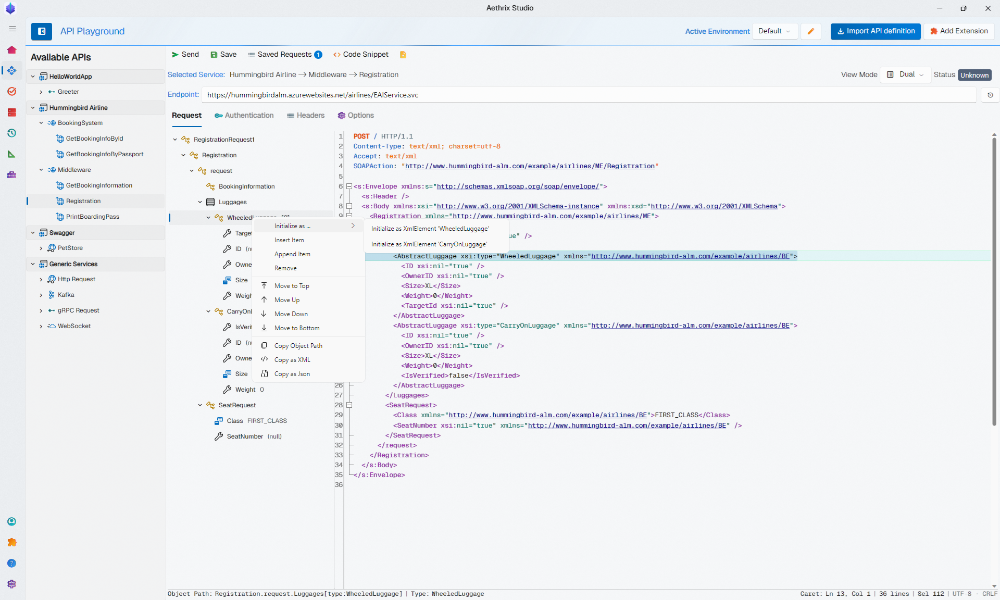

<!--
  Public landing page — AethrixHQ/.github → profile/README.md.
  Rendered on the organization profile page (github.com/AethrixHQ) for everyone.
  Marketing-focused: no repository names, no internal infrastructure. The member-only
  variant (repository table with links) lives in AethrixHQ/.github-private →
  profile/README.md — the two pages are intentionally different, keep the product
  facts consistent between them.
-->

<picture>
  <source media="(prefers-color-scheme: dark)" srcset="assets/studio-logo-dark.png">
  
</picture>

# Aethrix Studio

*Every API. One simple way to test.*

[English](#english) · [Français](#francais) · [简体中文](#zh-hans)

## 🇬🇧 English

**TEST · AUTOMATE · SIMULATE · AI-ASSISTED**

### Every API. One simple way to test.

Aethrix turns any API spec into **one live model** — manual testing, automation, service
simulation and load testing all work against it. It runs on **your machine**, so your
specs and your secrets never leave it.

`Free for individuals` · `No sign-up` · `Installs in under a minute` · `Windows · macOS · Linux`

  <picture>
    <source media="(prefers-color-scheme: dark)" srcset="assets/hero-dark.png">
    
  </picture>

| | |
|---|---|
| **Manual testing** — *object tree, not raw JSON* | Explore every endpoint with a structured editor that knows what each field expects. |
| **Test automation** | Build repeatable test suites with steps, assertions, data-driven inputs and load profiles. |
| **Service simulation** | Stub any endpoint with multiple responses, conditions, delays, faults and gRPC streaming. |
| **Ora — the AI assistant** (included) | Describe what you want. Ora fills requests, builds test suites, designs data and diagnoses failures. |

**Seven protocols. One object model.** Plus the APIs you design in place:
`OpenAPI 3.x` · `SOAP / WSDL` · `gRPC` · `GraphQL` · `OData` · `Apache Kafka` · `WebSocket` · `Custom schema`

**Human & AI, same model.** The object tree for you, tool calls for Ora — and an
agent-ready surface out of the box: `MCP · CLI · Daemon`. The Daemon serves your compiled
model as an MCP server, and the `aeth` CLI runs your tests in any pipeline.

**Native, not web.** Cold start under five seconds, no bundled browser engine — no Node,
no JVM, no Chromium. Telemetry: none. Network: optional — it runs fully offline; the cloud
account is only for licence and AI credits.

**Your machine. Your keys. Your data.**

- Specs, secrets and responses stay local by default — what leaves your machine is
  documented, and what stays, stays.
- BYOK: AI requests go **directly** from Aethrix Studio to your LLM provider — our servers
  never see your prompts (OpenAI, Anthropic, DeepSeek, private Azure, Ollama, on-prem endpoints).
- Data residency EU · US · CN · Global, selected at registration. SSO with Entra ID, Okta
  or Google Workspace. Enterprises can run fully air-gapped.

**The full platform is free right now** — every protocol, automation, simulation, and Ora.

Website · Download · Release notes — *coming soon*
<!--
  When the public site is live, replace the line above with:
  🌐 https://www.aethrixstudio.com · ⬇️ https://www.aethrixstudio.com/download · 🏷️ <current version>
-->

*Building the tools that build trust.*

---

## 🇫🇷 Français

**TESTER · AUTOMATISER · SIMULER · ASSISTÉ PAR IA**

### Toutes vos API. Une façon simple de tester.

Aethrix transforme n'importe quel contrat d'API en **un modèle vivant** — les tests
manuels, l'automatisation, la simulation de services et les tests de charge s'appuient
tous sur ce modèle. Il tourne sur **votre machine** : vos contrats et vos secrets ne la
quittent jamais.

`Gratuit pour les particuliers` · `Sans inscription` · `Installé en moins d'une minute` · `Windows · macOS · Linux`

  <picture>
    <source media="(prefers-color-scheme: dark)" srcset="assets/hero-dark.png">
    
  </picture>

| | |
|---|---|
| **Tests manuels** — *l'arbre d'objets, pas le JSON brut* | Explorez chaque endpoint avec un éditeur structuré qui connaît le format attendu de chaque champ. |
| **Automatisation des tests** | Composez des suites reproductibles : étapes, assertions, données de test et profils de charge. |
| **Simulation de services** | Stubbez n'importe quel endpoint : réponses multiples, conditions, délais, fautes et streaming gRPC. |
| **Assistant IA — Ora** (inclus) | Décrivez ce que vous voulez. Ora remplit les requêtes, construit les suites, conçoit les données et diagnostique les échecs. |

**Sept protocoles. Un modèle d'objets.** Et les API que vous créez directement dans l'outil :
`OpenAPI 3.x` · `SOAP / WSDL` · `gRPC` · `GraphQL` · `OData` · `Apache Kafka` · `WebSocket` · `Schéma personnalisé`

**L'humain et l'IA, un même modèle.** L'arbre d'objets pour vous, les appels d'outils pour
Ora — et une surface prête pour les agents dès l'installation : `MCP · CLI · Daemon`. Le
Daemon expose votre modèle compilé comme serveur MCP, et le CLI `aeth` exécute vos tests
dans n'importe quel pipeline.

**Natif, pas web.** Démarrage à froid en moins de cinq secondes, sans moteur de navigateur
embarqué — ni Node, ni JVM, ni Chromium. Télémétrie : aucune. Réseau : optionnel — il
fonctionne entièrement hors ligne ; le compte cloud ne sert qu'aux licences et aux crédits IA.

**Votre machine. Vos clés. Vos données.**

- Contrats, secrets et réponses restent locaux par défaut — ce qui quitte votre machine
  est documenté, ce qui reste, reste.
- BYOK : les requêtes IA vont **directement** d'Aethrix Studio vers votre fournisseur LLM —
  nos serveurs ne voient jamais vos prompts (OpenAI, Anthropic, DeepSeek, Azure privé,
  Ollama, endpoints on-prem).
- Résidence des données UE · US · CN · Global, choisie à l'inscription. SSO avec Entra ID,
  Okta ou Google Workspace. Les entreprises peuvent fonctionner totalement air-gapped.

**Toute la plateforme est gratuite pour le moment** — chaque protocole, l'automatisation,
la simulation, et Ora.

Site web · Téléchargement · Notes de version — *bientôt disponible*
<!--
  Quand le site public sera en ligne, remplacer la ligne ci-dessus par :
  🌐 https://www.aethrixstudio.com · ⬇️ https://www.aethrixstudio.com/download · 🏷️ <version courante>
-->

*Bâtissez une API fiable ; gagnez une confiance durable.*

---

## 🇨🇳 简体中文

**测试 · 自动化 · 模拟 · AI 辅助**

### 所有 API。一种至简的测试方式。

Aethrix 将任何 API 规范转化为**一个实时模型**——手动测试、自动化、服务模拟与负载测试
都基于它进行。它运行在**您的机器**上，您的规范与密钥不会离开本机。

`个人免费` · `无需注册` · `一分钟内完成安装` · `Windows · macOS · Linux`

  <picture>
    <source media="(prefers-color-scheme: dark)" srcset="assets/hero-dark.png">
    
  </picture>

| | |
|---|---|
| **手动测试** —— *对象树，而非原始 JSON* | 通过结构化编辑器探索每个端点，它知道每个字段的预期格式。 |
| **测试自动化** | 用步骤、断言、数据驱动输入与负载配置构建可重复的测试套件。 |
| **服务模拟** | 为任意端点创建桩：多重响应、条件、延迟、故障注入与 gRPC 流。 |
| **AI 助手 — Ora**（包含） | 说出您想要什么。Ora 会填充请求、构建测试套件、设计测试数据并诊断失败。 |

**七大协议。一个对象模型。** 还可以直接在工具中设计您自己的 API：
`OpenAPI 3.x` · `SOAP / WSDL` · `gRPC` · `GraphQL` · `OData` · `Apache Kafka` · `WebSocket` · `自定义 Schema`

**人与 AI，同一个模型。** 对象树给您，工具调用交给 Ora——开箱即用的 Agent 接入能力：
`MCP · CLI · Daemon`。Daemon 将您编译好的模型作为 MCP 服务器提供，`aeth` CLI 可在任意
流水线中执行您的测试。

**原生应用，而非网页。** 冷启动不到五秒，不捆绑浏览器引擎——没有 Node、没有 JVM、
没有 Chromium。遥测：无。网络：可选——完全离线运行；云账户仅用于许可与 AI 额度。

**您的机器。您的密钥。您的数据。**

- 规范、密钥与响应默认保存在本机——哪些数据会离开本机、哪些永远不会，都有公开文档说明。
- BYOK：AI 请求**直接**从 Aethrix Studio 发往您的 LLM 服务商——我们的服务器永远看不到
  您的提示词（OpenAI、Anthropic、DeepSeek、Azure 专用、Ollama、本地端点）。
- 数据驻留 EU · US · CN · Global，注册时选择。企业 SSO 支持 Entra ID、Okta、
  Google Workspace。企业可完全物理隔离运行。

**技术预览期间全平台免费** —— 所有协议、自动化、模拟与 Ora。

官网 · 下载 · 版本发布 —— *即将上线*
<!--
  公开网站上线后，将上一行替换为：
  🌐 https://www.aethrixstudio.com · ⬇️ https://www.aethrixstudio.com/download · 🏷️ <当前版本>
-->

*铸可信之器，成信赖之基。*

---

© 2026 Aethrix Labs

