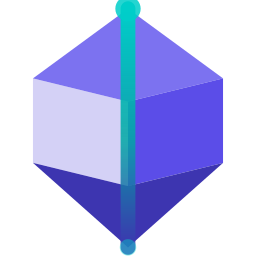

<!--
  Public landing page — AethrixHQ/.github → profile/README.md.
  Rendered on the organization profile page (github.com/AethrixHQ) for everyone.
  The member-only variant with links to the private repositories lives in
  AethrixHQ/.github-private → profile/README.md. Keep the two in sync when the
  product or repository layout changes; do not add private-repository links here.
-->

<picture>
  <source media="(prefers-color-scheme: dark)" srcset="assets/aethrix-logo-dark.svg">
  
</picture>

# Aethrix Labs

**Aethrix Studio** is an API testing platform: a cross-platform desktop IDE for manual
testing, automation, service simulation and an AI assistant, with a CLI for CI/CD and
cloud services behind it — accounts, licensing, billing and extension distribution.

[English](#english) · [Français](#francais) · [简体中文](#zh-hans)

## 🇬🇧 English

### Repositories

| Repository | What it holds |
|---|---|
| `aethrix-studio` | The Aethrix Studio desktop IDE (Avalonia 12 / .NET 10), the `aeth` CLI, the **Ora** AI assistant and the user documentation — plus the workspace engineering hub (plans, decisions, tracking) |
| `aethrix-services` | The cloud back-end services: accounts, activation & licensing, AI gateway, billing, extension hub |
| `aethrix-web` | The web properties: the marketing site and the account portal |
| `aethrix-extensions` | Extension and toolkit packages |
| `aethrix-design` | Brand and design-system masters |
| `aethrix-sdlc` | Azure Pipelines templates and workspace tooling shared by every repository |

### Inside Aethrix Studio

- **Manual testing** — REST, SOAP, gRPC, GraphQL, OData, Kafka, WebSocket
- **Automation** — performance and data-driven test campaigns
- **Service simulation** — stub remote dependencies with URL handlers
- **Ora** — the built-in AI assistant (preview)
- **`aeth` CLI** — run your tests in any CI/CD pipeline
- **UI automation** — Selenium-driven browser sessions

### CI/CD & infrastructure

- **Azure Pipelines** runs the workspace CI: a test gate on every push and pull request
  (offline fast tier), cross-platform packaging (Windows, macOS and Linux installers), and
  approval-gated manual publishing for packages and releases. Pipeline templates are shared
  from `aethrix-sdlc` so every repository enforces the same gates; GitHub Actions adds a
  consistency check on the engineering tracking files.
- Hosted on **Microsoft Azure**: App Service for the web properties and identity endpoints,
  Cosmos DB as the data store, Blob Storage for release distribution.
- **Central identity** — AccountService is the root of trust and issues signed tokens
  carrying license and feature claims; sign in with a Microsoft, Google or
  WeChat/Alipay (China) account.
- **Your data, your keys** — the extension hub is designed to be self-hosted, and BYOK
  routing keeps AI prompts on your own provider keys.

---

## 🇫🇷 Français

**Aethrix Studio** est une plateforme de test d'API : un IDE de bureau multiplateforme pour
les tests manuels, l'automatisation (performance et pilotée par les données), la simulation
de services et un assistant IA, avec un CLI pour l'intégration continue et, derrière, des
services cloud — comptes, licences, facturation et distribution d'extensions.

### Dépôts

| Dépôt | Contenu |
|---|---|
| `aethrix-studio` | L'IDE de bureau Aethrix Studio (Avalonia 12 / .NET 10), le CLI `aeth`, l'assistant IA **Ora** et la documentation utilisateur — plus le centre d'ingénierie de l'espace de travail (plans, décisions, suivi) |
| `aethrix-services` | Les services back-end cloud : comptes, activation & licences, passerelle IA, facturation, hub d'extensions |
| `aethrix-web` | Les propriétés web : le site vitrine et le portail de comptes |
| `aethrix-extensions` | Les paquets d'extensions et de boîtes à outils |
| `aethrix-design` | Les sources de la marque et du design system |
| `aethrix-sdlc` | Les modèles Azure Pipelines et l'outillage partagés par tous les dépôts |

### Dans Aethrix Studio

- **Tests manuels** — REST, SOAP, gRPC, GraphQL, OData, Kafka, WebSocket
- **Automatisation** — campagnes de tests de performance et pilotées par les données
- **Simulation de services** — stubbez les dépendances distantes avec des gestionnaires d'URL
- **Ora** — l'assistant IA intégré (aperçu)
- **CLI `aeth`** — exécutez vos tests dans n'importe quel pipeline CI/CD
- **Automatisation d'interface** — sessions de navigateur pilotées par Selenium

### CI/CD & infrastructure

- **Azure Pipelines** exécute la CI de l'espace de travail : un verrou de tests à chaque
  push et pull request (batterie rapide hors ligne), l'empaquetage multiplateforme
  (installeurs Windows, macOS et Linux), et une publication manuelle avec approbation pour
  les paquets et les releases. Les modèles de pipeline sont partagés depuis `aethrix-sdlc`
  afin que chaque dépôt applique les mêmes verrous ; GitHub Actions ajoute un contrôle de
  cohérence des fichiers de suivi d'ingénierie.
- Hébergé sur **Microsoft Azure** : App Service pour les propriétés web et les points de
  terminaison d'identité, Cosmos DB comme magasin de données, Blob Storage pour la
  distribution des releases.
- **Identité centralisée** — AccountService est la racine de confiance et émet des jetons
  signés portant les claims de licence et de fonctionnalités ; connectez-vous avec un
  compte Microsoft, Google ou WeChat/Alipay (Chine).
- **Vos données, vos clés** — le hub d'extensions est conçu pour être auto-hébergé, et le
  routage BYOK garde les requêtes IA sur vos propres clés de fournisseur.

---

## 🇨🇳 简体中文

**Aethrix Studio** 是一个 API 测试平台：跨平台桌面 IDE，覆盖手动测试、自动化（性能与数据驱动）、
服务模拟与 AI 助手，并提供面向 CI/CD 的 CLI；后端由云服务支撑——账户、许可、计费与扩展分发。

### 仓库

| 仓库 | 内容 |
|---|---|
| `aethrix-studio` | Aethrix Studio 桌面 IDE（Avalonia 12 / .NET 10）、`aeth` CLI、AI 助手 **Ora** 与用户文档——也是整个工作区的工程中枢（规划、决策与跟踪） |
| `aethrix-services` | 云端后端服务：账户、激活与许可、AI 网关、计费、扩展中心 |
| `aethrix-web` | Web 应用：官网与账户门户 |
| `aethrix-extensions` | 扩展与工具包 |
| `aethrix-design` | 品牌与设计系统源文件 |
| `aethrix-sdlc` | 所有仓库共享的 Azure Pipelines 模板与工作区工具 |

### Aethrix Studio 内置模块

- **手动测试** — REST、SOAP、gRPC、GraphQL、OData、Kafka、WebSocket
- **自动化** — 性能测试与数据驱动测试
- **服务模拟** — 通过 URL 处理器为远程依赖打桩
- **Ora** — 内置 AI 助手（预览版）
- **`aeth` CLI** — 在任意 CI/CD 流水线中执行测试
- **UI 自动化** — Selenium 驱动的浏览器会话

### CI/CD 与基础设施

- **Azure Pipelines** 承载整个工作区的 CI：每次 push 与 PR 都会运行测试门禁（离线快速档），
  跨平台打包（Windows、macOS、Linux 安装包），包与版本的发布使用带审批的手动流水线。
  流水线模板统一由 `aethrix-sdlc` 共享，确保每个仓库执行相同的门禁；GitHub Actions 负责
  工程跟踪文件的一致性检查。
- 托管于 **Microsoft Azure**：App Service 承载 Web 应用与身份端点，Cosmos DB 作为数据存储，
  Blob Storage 用于版本分发。
- **集中式身份** — AccountService 是信任根，签发携带许可与功能声明的签名令牌；支持
  Microsoft、Google 或微信/支付宝（中国区）登录。
- **数据主权** — 扩展中心设计为可自托管，BYOK 路由让 AI 请求使用您自己的服务商密钥。

---

© 2026 Aethrix Labs

